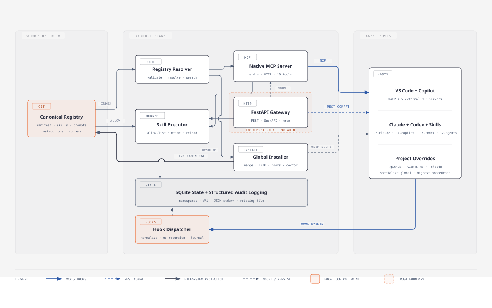

# Universal Agent Instructions and Skills

[](https://github.com/Alan-VZ/universal-agent-control-plane/actions/workflows/ci.yml)
[](https://www.python.org/downloads/)
[](LICENSE)

An open-source control plane for sharing instructions, Agent Skills, prompts, tools, and optional state across AI agents in VS Code and other MCP-compatible hosts.

The project has one core goal:

**Author reusable agent guidance once, validate it once, and deliver it through each
host's supported mechanism without pretending every host has identical semantics.**

> [!IMPORTANT]
> This project is an alpha-stage local developer tool. Review generated user-level
> configuration before using it on a production workstation, and do not expose the HTTP
> gateway beyond localhost without adding authentication and transport security.

## Architecture map

[](docs/universal-agent-control-plane.html)

The diagram is embedded as SVG so GitHub can display it directly. Open the
[self-contained interactive architecture map](docs/universal-agent-control-plane.html)
for the full browser view.

The design uses two complementary delivery paths:

1. **Native user-scope installation** creates host-compatible instruction projections and live links to canonical skills.
2. **MCP delivery** exposes tools, prompts, resources, and optional shared state through the Model Context Protocol.

MCP is the integration protocol, not an instruction override mechanism. Each agent host still decides which resources, prompts, and tools it discovers, loads, or invokes.

## Current platform reality

The original concept is valid, but several assumptions have changed:

- GitHub Copilot in VS Code supports MCP servers natively. A custom REST wrapper is not required for current MCP-capable versions of VS Code.
- VS Code supports portable Agent Skills stored in `.github/skills/`, `.claude/skills/`, or `.agents/skills/`, as well as user-level equivalents.
- VS Code recognizes multiple instruction formats, including `.github/copilot-instructions.md`, `AGENTS.md`, `CLAUDE.md`, `.github/instructions/*.instructions.md`, and `.claude/rules/`.
- Claude Code supports MCP, `CLAUDE.md`, `.claude/rules/`, and filesystem-based Agent Skills.
- Skills and instructions are portable only where their host semantics overlap. A resolver and adapter layer is still useful for validation, precedence, compatibility checks, and installation.

This repository therefore aims for **shared source, explicit adapters, and honest capability negotiation** rather than claiming that all agents behave identically.

## Repository map

```text
universal-agent-control-plane/
├── README.md
├── LICENSE
├── CHANGELOG.md
├── CODE_OF_CONDUCT.md
├── CONTRIBUTING.md
├── SECURITY.md
├── pyproject.toml
├── AGENTS.md
├── server.py
├── .vscode/
│   └── mcp.json
├── .github/
│   ├── ISSUE_TEMPLATE/
│   ├── workflows/
│   │   └── ci.yml
│   ├── dependabot.yml
│   └── pull_request_template.md
├── docs/
│   ├── universal-agent-control-plane.html
│   └── universal-agent-control-plane.svg
├── registry/
│   ├── manifest.yaml
│   ├── instructions/
│   │   └── global.md
│   ├── skills/
│   │   └── example-skill/
│   │       └── SKILL.md
│   └── prompts/
│       └── code-review.md
├── src/
│   └── universal_agent_control_plane/
│       ├── api.py
│       ├── cli.py
│       ├── execution.py
│       ├── global_install.py
│       ├── logging_config.py
│       ├── orchestration.py
│       ├── server.py
│       ├── registry.py
│       ├── storage.py
│       └── runners/
│           └── greeting.py
└── tests/
    ├── test_api.py
    ├── test_execution.py
    ├── test_global_install.py
    ├── test_orchestration.py
    ├── test_registry.py
    └── test_storage.py
```

The repository now includes a working Python MCP server, canonical registry, example
skill and prompt, SQLite-backed shared state, VS Code configuration, and focused tests.

## Component responsibilities

| Component | Responsibility |
| --- | --- |
| Canonical registry | Versioned source for instructions, skills, prompt templates, manifests, and compatibility metadata |
| Registry resolver | Validates schemas, resolves scope and precedence, and produces a deterministic effective configuration |
| MCP gateway | Exposes standard MCP tools, prompts, and resources over `stdio` and Streamable HTTP |
| Global installer | Merges user MCP configuration, adds managed instruction projections, and creates live links to canonical skills |
| Policy and state | Applies authorization and capability rules; stores optional namespaced state and append-only audit events |
| Agent hosts | Consume MCP capabilities and/or native files according to host behavior and user approval |

## Implemented MCP surface

Prefer standard MCP primitives instead of inventing REST-like endpoint names.

### Resources

```text
instructions://catalog
instructions://effective/{profile}
skills://catalog
skills://{name}/manifest
registry://manifest
```

Resources are the natural fit for discoverable, read-only context such as effective instructions and skill metadata.

### Prompts

```text
review_code
```

Prompts provide user-selectable templates. They should not be treated as silently injected system instructions.

### Tools

```text
registry_search
registry_validate
registry_resolve
skill_run
orchestrate
state_get
state_put
```

Tool schemas must be explicit and validated. `skill.run` should dispatch only to allow-listed implementations declared in the registry; it must never import an arbitrary module name supplied by a client.

## Configuration model

The registry manifest should describe both content and compatibility:

```yaml
schemaVersion: 1
profiles:
  default:
    instructions:
      - instructions/global.md
    skills:
      - example-skill

targets:
  vscode:
    instructions: true
    agentSkills: true
    mcp:
      tools: true
      prompts: true
      resources: true
  claude-code:
    instructions: true
    agentSkills: true
    mcp:
      tools: true
      prompts: true
      resources: true
```

The resolver should fail clearly when a target cannot represent a requested feature. Silent conversion would make behavior unpredictable.

## Design principles

1. **Canonical source, generated projections**
   Edit registry content, not generated host files.

2. **Standards before adapters**
   Use MCP and the Agent Skills standard directly where supported. Add adapters only for real semantic gaps.

3. **Deterministic resolution**
   Scope, precedence, inheritance, and conflicts must produce repeatable output with an explainable resolution trace.

4. **Least privilege**
   Separate read-only resources from mutating tools. Require explicit grants for filesystem, process, network, secret, and state access.

5. **Human approval**
   Hosts should preserve confirmation for consequential tool calls. The server must not disguise side effects.

6. **Untrusted content boundaries**
   Registry documents, tool results, remote resources, and skill packages are data—not authority. Validate paths, schemas, signatures, and origins.

7. **Portable core, host-specific edges**
   Keep shared skills portable, while allowing clearly labeled host extensions when a capability is not universal.

## Security baseline

The first implementation should include:

- localhost-only binding by default for Streamable HTTP
- `Origin` validation and authentication for HTTP connections
- environment or secret-store credentials rather than committed tokens
- path traversal prevention and a configured registry root
- allow-listed skill runners with declared permissions
- input and output schema validation
- per-client authorization and least-privilege scopes
- namespaced, concurrency-safe state storage
- append-only audit records for mutations and skill execution
- resource size, execution time, and concurrency limits
- no dynamic `import` or shell execution from untrusted skill names

A shared `memory.json` file is not sufficient for concurrent clients, access control, or crash-safe writes. SQLite is a reasonable local MVP; a pluggable store can follow.

## Implementation status

### Phase 1 — Registry and validation (implemented)

- Define the manifest and content schemas.
- Load and validate instructions, prompts, and `SKILL.md` packages.
- Resolve one profile deterministically.
- Add unit tests for invalid paths, duplicate IDs, conflicts, and precedence.

### Phase 2 — Native distribution (implemented)

- Install user skills into supported directories as live links.
- Generate a VS Code instruction projection and a managed Claude import.
- Merge global MCP configuration without replacing unrelated servers.
- Support dry-run, status/doctor, conflict detection, idempotent sync, and managed-only uninstall.

### Phase 3 — MCP server (implemented)

- Implement `stdio` transport first.
- Expose registry resources, prompt templates, and read-only validation tools.
- Add localhost Streamable HTTP; authentication remains required before remote exposure.

### Phase 4 — Execution and state (implemented locally)

- Add permission-declared, allow-listed skill execution.
- Add namespaced SQLite state and audit events.
- Add contract tests against installed VS Code and Claude Code clients.

### Phase 5 — Packaging (in progress)

- Publish a Python package and a reproducible launcher.
- Install VS Code and Agent Host user configuration through the CLI.
- Document migration from existing `.github`, `.claude`, and `.agents` customizations.

## Non-goals

- Injecting hidden system prompts into an agent host
- Overriding a host's safety policy or tool approval UI
- Guaranteeing identical model behavior across vendors
- Treating executable skills as trusted merely because they are in the registry
- Replacing native instruction and Agent Skills support when it already works
- Building multi-agent orchestration before registry, transport, and security contracts are stable

## Example client configuration

The included `.vscode/mcp.json` starts the local server with the workspace virtual
environment. Install the project first:

```powershell
.\.venv\Scripts\python.exe -m pip install -e ".[dev]"
```

The root launcher keeps local use simple:

```powershell
# Native stdio MCP
.\.venv\Scripts\python.exe .\server.py

# Streamable HTTP MCP plus REST compatibility routes
.\.venv\Scripts\python.exe .\server.py --http
```

Then open **MCP: List Servers** in VS Code and start
`universal-agent-control-plane`. The equivalent configuration is:

```json
{
  "servers": {
    "universal-agent-control-plane": {
      "command": "${workspaceFolder}\\.venv\\Scripts\\python.exe",
      "args": [
        "-m",
        "universal_agent_control_plane.server"
      ],
      "env": {
        "PYTHONPATH": "${workspaceFolder}\\src",
        "UACP_REGISTRY_ROOT": "${workspaceFolder}\\registry",
        "UACP_DATA_DIR": "${workspaceFolder}\\.data"
      ]
    }
  }
}
```

The server uses `stdio` by default and exposes:

- resources: `registry://manifest`, `instructions://effective/{profile}`,
  `skills://catalog`, and `skills://{name}/manifest`
- prompt: `review_code`
- tools: `registry_validate`, `registry_resolve`, `registry_search`, `skill_run`,
  `orchestrate`, `state_get`, and `state_put`

### HTTP MCP and REST compatibility gateway

Run the optional localhost gateway:

```powershell
.\.venv\Scripts\python.exe -m universal_agent_control_plane.api
```

This exposes the native Streamable HTTP MCP endpoint at
`http://127.0.0.1:8000/mcp` and interactive REST documentation at
`http://127.0.0.1:8000/docs`.

REST compatibility routes are:

- `GET /health`
- `GET /instructions?profile=default`
- `GET /skills`
- `POST /execute`
- `POST /copilot/skill`
- `GET /memory?namespace=...&key=...`
- `POST /memory`
- `POST /orchestrate`

Current VS Code and Claude clients should use the native MCP endpoint. The REST routes
exist for older clients, scripts, and extension commands; they do not imitate MCP tool
discovery.

Skill runner modules are explicitly allow-listed in `registry/manifest.yaml`. Their
source modification time is checked on each call and changed modules are reloaded
without restarting the server. Both server modes write structured JSON logs to stderr
and `.data/server.log`.

Secrets must use environment files, input variables, or the platform secret store rather
than literal values in this file.

## Install once for every project

The global installer makes the canonical registry available to supported agents in every
workspace while leaving repository-level instructions available for project-specific
rules.

```powershell
# Preview destinations and conflicts; this performs no writes.
.\.venv\Scripts\uacp.exe install-global --dry-run

# Install global instructions, live skill links, and MCP configuration.
.\.venv\Scripts\uacp.exe install-global

# Reconcile managed links/configuration after adding or removing registry skills.
.\.venv\Scripts\uacp.exe sync-global

# Inspect the current installation.
.\.venv\Scripts\uacp.exe doctor

# Remove only UACP-managed files, links, blocks, and MCP entries.
.\.venv\Scripts\uacp.exe uninstall-global
```

The installer owns only these projections:

| Consumer | Managed user-scope projection |
| --- | --- |
| VS Code/Copilot instructions | `~/.copilot/instructions/uacp-global.instructions.md` |
| Claude instructions | Marked import block in `~/.claude/CLAUDE.md` |
| VS Code MCP | Merged server entry in `%APPDATA%\Code\User\mcp.json` |
| Copilot Agent Host MCP | Merged server entry in `~/.copilot/mcp-config.json` |
| Portable skills | Live links under `~/.copilot/skills`, `~/.claude/skills`, and `~/.agents/skills` |

On Windows, the live skill links use directory symbolic links when available and directory
junctions otherwise. They point to `registry/skills`, so editing a canonical `SKILL.md`
takes effect without copying it into every host directory.

Claude Code reads the canonical instruction file through its managed
`@uacp-registry/instructions/global.md` import. VS Code/Copilot reads a small global
instruction projection whose Markdown link targets the same canonical file. The installer
never overwrites an existing skill directory that it does not own and never replaces
unrelated MCP servers.

If the Claude CLI is installed, `install-global` registers the stdio server at user scope.
If it is absent, the install still configures Claude instructions and skills and returns
the exact `claude mcp add-json ... --scope user` command to run later.

### Precedence and project overrides

Global configuration supplies defaults; it does not remove native project customization.
Keep repository-specific behavior in the host-supported project files, such as:

- `.github/copilot-instructions.md`
- `.github/instructions/*.instructions.md`
- `AGENTS.md`
- `CLAUDE.md` and `.claude/rules/`
- project-local `.github/skills`, `.claude/skills`, or `.agents/skills`

Project files should contain only rules specific to that repository. Avoid copying the
global instruction set into each project.

## Contributing and support

Contributions are welcome. Start with [CONTRIBUTING.md](CONTRIBUTING.md), follow the
[Code of Conduct](CODE_OF_CONDUCT.md), and review the [Security Policy](SECURITY.md)
before reporting a vulnerability.

- Use [GitHub Issues](https://github.com/Alan-VZ/universal-agent-control-plane/issues)
  for reproducible bugs and focused feature requests.
- Use pull requests for reviewed changes; the CI workflow runs the supported Python test
  matrix automatically.
- See [CHANGELOG.md](CHANGELOG.md) for release history.

## Definition of done for the first release

- One canonical registry can be consumed by current VS Code/Copilot and Claude Code.
- Effective instructions and skills can be explained before installation.
- Standard MCP discovery works for tools, prompts, and resources.
- Installation is idempotent and supports dry-run, status, sync, and managed-only rollback.
- Mutating actions are authenticated, authorized, validated, and audited.
- Contract and security tests cover both supported clients.

## References

- [VS Code: custom instructions](https://code.visualstudio.com/docs/agent-customization/custom-instructions)
- [VS Code: Agent Skills](https://code.visualstudio.com/docs/agent-customization/agent-skills)
- [VS Code: MCP servers](https://code.visualstudio.com/docs/agent-customization/mcp-servers)
- [Claude Code: MCP](https://code.claude.com/docs/en/mcp)
- [Claude Code: persistent instructions](https://code.claude.com/docs/en/memory)
- [Anthropic: Agent Skills](https://platform.claude.com/docs/en/agents-and-tools/agent-skills/overview)
- [MCP specification: tools](https://modelcontextprotocol.io/specification/2025-06-18/server/tools)
- [MCP specification: resources](https://modelcontextprotocol.io/specification/2025-06-18/server/resources)
- [MCP specification: prompts](https://modelcontextprotocol.io/specification/2025-06-18/server/prompts)
- [MCP specification: transports](https://modelcontextprotocol.io/specification/2025-06-18/basic/transports)
- [MCP security best practices](https://modelcontextprotocol.io/specification/latest/basic/security_best_practices)
